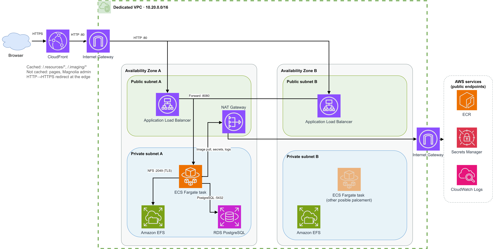
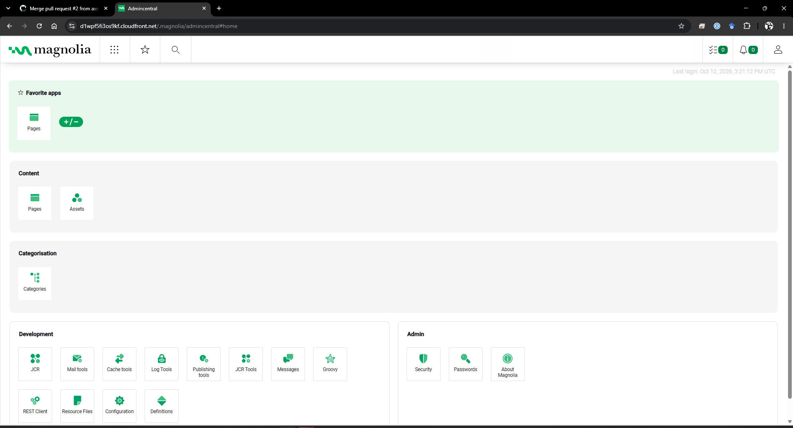

# Crescendo-DevOps-exam

Magnolia CMS Community Edition on AWS, deployed with Terraform and GitHub Actions. It runs on ECS Fargate behind an ALB and CloudFront, with PostgreSQL on RDS and EFS for persistent state.



Design decisions, deviations from the exam brief, and limitations are in [docs/architecture.md](docs/architecture.md).

## Magnolia running on AWS

Magnolia AdminCentral running and served through the CloudFront URL:



## Run locally

Requires Docker Engine and the Docker Compose plugin.

```sh
cp .env.example .env   # set DB_USER, DB_PASSWORD, MAGNOLIA_SUPERUSER_PASSWORD
docker compose --env-file .env -f docker/docker-compose.yml up --build
```

Open <http://localhost:8080> and sign in as `superuser` with `MAGNOLIA_SUPERUSER_PASSWORD`. First-run setup is automatic.

Stop with `docker compose --env-file .env -f docker/docker-compose.yml down` (data is kept; add `-v` to delete it).

## Deploy to AWS

Prerequisites: Terraform 1.10+, AWS CLI v2, Docker, `jq`, and AWS credentials for the target account. The default region is `us-east-1`; for another region, add `-var="aws_region=REGION"` to the bootstrap commands, set `aws_region` in `terraform/terraform.tfvars`, and set `AWS_REGION` for the image script and GitHub variables.

This creates billable resources (ALB, NAT Gateway, RDS, EFS, CloudFront). Destroy the stack when finished.

### 1. Bootstrap (once)

Creates the Terraform state bucket and the GitHub OIDC roles:

```sh
terraform -chdir=terraform/bootstrap init
terraform -chdir=terraform/bootstrap apply
```

Keep `terraform/bootstrap/terraform.tfstate` private; it is local state. If your account already has the GitHub OIDC provider, or you use another repository, see [docs/architecture.md](docs/architecture.md#cicd-and-iam).

### 2. Configure the main stack

```sh
cat > terraform/backend.hcl <<EOF
bucket       = "$(terraform -chdir=terraform/bootstrap output -raw state_bucket_name)"
key          = "magnolia/terraform.tfstate"
region       = "$(terraform -chdir=terraform/bootstrap output -raw state_bucket_region)"
use_lockfile = true
EOF
cp terraform/terraform.tfvars.example terraform/terraform.tfvars
terraform -chdir=terraform init -backend-config=backend.hcl
```

### 3. Deploy

Through GitHub Actions: add these repository variables under **Settings → Secrets and variables → Actions → Variables**, then merge to `main`.

- `TERRAFORM_STATE_BUCKET`: `terraform -chdir=terraform/bootstrap output -raw state_bucket_name`
- `TERRAFORM_PLAN_ROLE_ARN`: `terraform -chdir=terraform/bootstrap output -raw github_plan_role_arn`
- `TERRAFORM_DEPLOY_ROLE_ARN`: `terraform -chdir=terraform/bootstrap output -raw github_deploy_role_arn`
- `AWS_REGION`: only if not `us-east-1`

No AWS access keys or secrets are needed; GitHub authenticates through OIDC. Pull requests run `terraform fmt`, `validate`, and `plan`. A push to `main` applies the infrastructure, pushes the image, restarts ECS, and invalidates CloudFront.

Manually, apply first, then push the image and restart ECS:

```sh
terraform -chdir=terraform apply
AWS_REGION=us-east-1 ./scripts/build-and-push-image.sh latest
aws ecs update-service --region us-east-1 \
  --cluster "$(terraform -chdir=terraform output -raw ecs_cluster_name)" \
  --service "$(terraform -chdir=terraform output -raw ecs_service_name)" \
  --force-new-deployment
```

### 4. Open Magnolia

Use the same AWS profile that deployed the stack:

```sh
terraform -chdir=terraform output -raw cloudfront_url
aws secretsmanager get-secret-value \
  --secret-id "$(terraform -chdir=terraform output -raw application_secret_arn)" \
  --query SecretString --output text | jq -r .magnolia_superuser_password
```

Sign in at `<cloudfront_url>/.magnolia/admincentral` as `superuser`. The first start can take several minutes.

### Destroy

```sh
terraform -chdir=terraform destroy
```

This deletes the database and EFS data without a final snapshot.
