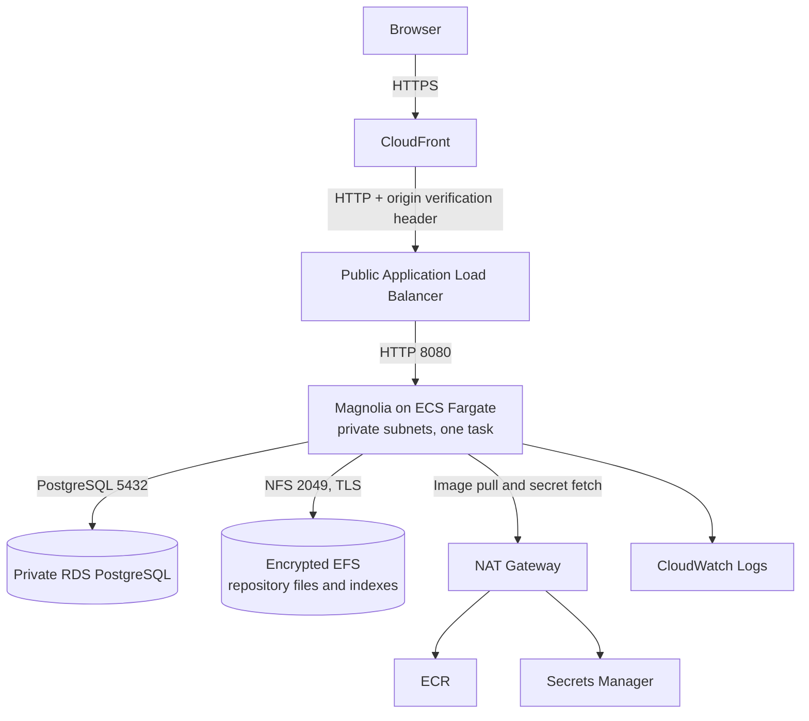

# Crescendo-DevOps-exam

## Architecture



This implementation intentionally uses ECS Fargate rather than EC2, RDS PostgreSQL and EFS for persistent Magnolia state, and omits Nginx: the ALB provides the HTTP entry point and target health checks. These are documented deviations from the exam brief. Magnolia is configured as a single task because this Jackrabbit setup is not clustered.

## Run Magnolia locally

Requirements: Docker Engine and the Docker Compose plugin.

1. Copy `.env.example` to `.env` and set strong values for `DB_USER`, `DB_PASSWORD`, and `MAGNOLIA_SUPERUSER_PASSWORD`. The local `.env` is ignored by Git:

   ```sh
   cp .env.example .env
   ```

2. From the repository root, start the services:

   ```sh
   docker compose --env-file .env -f docker/docker-compose.yml up --build
   ```

3. Open [http://localhost:8080](http://localhost:8080). Magnolia performs its first-run setup automatically; sign in with username `superuser` and the value of `MAGNOLIA_SUPERUSER_PASSWORD`.

Magnolia settings are kept in readable files under `docker/config/`. Static Magnolia properties are added to the webapp at image build time. At container startup, `envsubst` renders only the Jackrabbit XML template with the database connection details, then Magnolia initializes its repository against PostgreSQL.

To stop the services while retaining the database:

```sh
docker compose --env-file .env -f docker/docker-compose.yml down
```

## Additional considerations

Magnolia stores JCR workspace content and binaries in PostgreSQL in this configuration. Jackrabbit still uses the filesystem for repository metadata, workspace configuration, and Lucene search indexes. A named Docker volume (`magnolia-data`) persists that repository directory across container replacements. The Magnolia activation and password-manager key files are also configured inside this volume. Caches, temporary upload files, and container logs remain ephemeral; Docker exposes application output with `docker compose logs`.

This follows Magnolia's [database setup guidance](https://docs.magnolia-cms.com/product-docs/getting-started-with-magnolia/installing-magnolia/database-sizing-and-setup/) to store binaries in the database, and its [workspace configuration guidance](https://docs.magnolia-cms.com/performance-tuning/installation-and-configuration/workspace-configuration/) that distinguishes database-backed content from on-disk workspace configuration and indexes. [Jackrabbit's repository configuration docs](https://jackrabbit.apache.org/jcr/jackrabbit-configuration.html) describe the repository home as holding indexes and internal configuration; Magnolia notes that indexes can be regenerated.

Back up both the PostgreSQL database and `magnolia-data` for a complete recovery. Restore them together. Lucene indexes can be regenerated, but retaining the volume avoids a full reindex and preserves repository metadata and generated keys. The superuser password is written to a private temporary file inside the container for Magnolia's first-run bootstrap; it is only applied during initial setup. Changing it in `.env` after the database has been initialized does not change the existing account password.

`DB_PASSWORD` is also used only when PostgreSQL initializes a new data volume. If you change it later, update the existing PostgreSQL role password to match before restarting Magnolia; changing `.env` alone does not alter credentials stored in the persistent database.

The `down` command above removes containers but keeps both named volumes. `docker compose down -v` also deletes the database and Magnolia repository data.

## Deploy to AWS

### Prerequisites

- Terraform 1.10 or newer, AWS CLI v2, Docker, `jq`, and an AWS identity with permission to create the resources in this stack. Terraform 1.10+ is required for native S3 state locking.
- Configure AWS CLI credentials for the target account and select the deployment region. The default region is `us-east-1`.
- To deploy outside `us-east-1`, create the bootstrap bucket in the target region, set the same `aws_region` for the main Terraform stack, and set `AWS_REGION` to that region when running the image-push script and GitHub Actions workflow.
- Terraform state contains generated database and Magnolia credentials; keep it private and never commit it.

The stack creates billable AWS resources, including an Application Load Balancer, one NAT Gateway, RDS, EFS, and CloudFront. Review current pricing for your chosen region and destroy the stack when finished.

### Bootstrap remote state

The main Terraform configuration stores its state in S3 and uses S3 lockfiles (`.tflock`) to prevent concurrent applies. First, create the bucket with the separate bootstrap configuration:

```sh
terraform -chdir=terraform/bootstrap init
terraform -chdir=terraform/bootstrap plan
terraform -chdir=terraform/bootstrap apply
```

The bootstrap creates a bucket named from the configured prefix, AWS account ID, and region. It enables versioning, server-side encryption, public-access blocking, and a bucket policy that denies non-TLS requests. The bucket has Terraform `prevent_destroy` protection.

It also configures GitHub Actions OIDC and creates two IAM roles: a read-only plan role trusted for pull requests, and an administrator deployment role trusted only for pushes to `main`. The OIDC trust uses GitHub's immutable numeric owner/repository IDs as part of each subject claim; if you use another repository or owner, update `github_repository`, `github_owner_id`, and `github_repository_id`. AWS allows only one OIDC provider per issuer per account: if `https://token.actions.githubusercontent.com` already exists, pass its ARN with `-var="github_oidc_provider_arn=ARN"` when planning and applying bootstrap so Terraform reuses it.

To check whether your account already has the provider:

```sh
aws iam list-open-id-connect-providers --query 'OpenIDConnectProviderList[].Arn' --output text
```

If you change the main Terraform `name` from its default, set bootstrap's `application_name_prefix` to the same value so the plan role can read the generated secret during planning.

The deployment role has the AWS-managed `AdministratorAccess` policy, as chosen for this interview deployment. Its OIDC trust is limited to this repository's `main` branch; protect `main` with required pull requests and status checks. The plan role uses `ReadOnlyAccess` plus access to the Terraform state and lockfile. Terraform state contains generated credentials, so only trusted same-repository pull requests receive AWS plan credentials; fork pull requests run format and validation only. This is a practical demo setup, not a least-privilege production policy.

For a region other than `us-east-1`, add `-var="aws_region=REGION"` to the bootstrap `plan` and `apply` commands above, and set `aws_region = "REGION"` in the main stack's ignored `terraform/terraform.tfvars`.

The bootstrap's own state remains local because the S3 bucket does not exist until bootstrap completes. Keep `terraform/bootstrap/terraform.tfstate` private and backed up; do not commit it. The main infrastructure state is stored remotely in the new bucket.

Create the ignored backend config for the main stack using the outputs from bootstrap:

```sh
STATE_BUCKET=$(terraform -chdir=terraform/bootstrap output -raw state_bucket_name)
STATE_REGION=$(terraform -chdir=terraform/bootstrap output -raw state_bucket_region)
cat > terraform/backend.hcl <<EOF
bucket       = "$STATE_BUCKET"
key          = "magnolia/terraform.tfstate"
region       = "$STATE_REGION"
use_lockfile = true
EOF
```

`terraform/backend.hcl` is ignored by Git. Initialize the main stack with it:

```sh
terraform -chdir=terraform init -backend-config=backend.hcl
```

If you already have a local main-stack state from an earlier apply, migrate it instead:

```sh
terraform -chdir=terraform init -migrate-state -backend-config=backend.hcl
```

Add the bootstrap outputs as GitHub repository variables under **Settings → Secrets and variables → Actions → Variables**:

- `TERRAFORM_STATE_BUCKET`: `terraform -chdir=terraform/bootstrap output -raw state_bucket_name`
- `TERRAFORM_PLAN_ROLE_ARN`: `terraform -chdir=terraform/bootstrap output -raw github_plan_role_arn`
- `TERRAFORM_DEPLOY_ROLE_ARN`: `terraform -chdir=terraform/bootstrap output -raw github_deploy_role_arn`
- `AWS_REGION`: deployment region, if not `us-east-1`

These are role and bucket identifiers, not credentials. Do not create GitHub AWS access-key secrets or an IAM user for CI; GitHub exchanges its short-lived OIDC token directly for role credentials.

### Provision infrastructure and publish the image

Create a local Terraform variables file from the example. It is ignored by Git:

```sh
cp terraform/terraform.tfvars.example terraform/terraform.tfvars
terraform -chdir=terraform init -backend-config=backend.hcl
```

Apply the full stack first. Terraform creates the ECR repository and ECS service; without an image in ECR, the task may report image-pull failures temporarily. Terraform does not wait for ECS steady state, so apply can complete. Then build and push the configured image tag:

```sh
terraform -chdir=terraform plan
terraform -chdir=terraform apply
IMAGE_TAG=latest
AWS_REGION=REGION ./scripts/build-and-push-image.sh "$IMAGE_TAG"
```

Use the same region as `aws_region` in `terraform/terraform.tfvars`. After pushing, force ECS to pull the new image:

```sh
aws ecs update-service \
  --cluster "$(terraform -chdir=terraform output -raw ecs_cluster_name)" \
  --service "$(terraform -chdir=terraform output -raw ecs_service_name)" \
  --force-new-deployment \
  --region REGION
aws ecs wait services-stable \
  --cluster "$(terraform -chdir=terraform output -raw ecs_cluster_name)" \
  --services "$(terraform -chdir=terraform output -raw ecs_service_name)" \
  --region REGION
```

For subsequent releases, pushing an updated `latest` image and forcing a new ECS deployment is sufficient. Alternatively, use unique tags by updating `image_tag` in `terraform/terraform.tfvars`, applying Terraform, then pushing that tag and restarting ECS.

After the ECS task becomes healthy and CloudFront finishes deploying, get the site URL:

```sh
terraform -chdir=terraform output -raw cloudfront_url
```

Retrieve the generated Magnolia admin password from Secrets Manager when you are ready to log in:

```sh
aws secretsmanager get-secret-value \
  --secret-id "$(terraform -chdir=terraform output -raw application_secret_arn)" \
  --query SecretString \
  --output text | jq -r .magnolia_superuser_password
```

The initial Magnolia superuser and database passwords are generated and stored in Secrets Manager. The task execution role reads those values at task startup. Terraform state also contains the generated secret values, so protect state as a credential store.

### Continuous integration

The GitHub Actions validation workflow runs `terraform fmt`, `validate`, and `plan` on pull requests. Forked pull requests run formatting and validation but skip AWS planning. On every push to `main`, the deployment workflow first applies the full Terraform stack (including ECR and ECS), then builds and pushes the image tagged `latest`, forces an ECS deployment, waits for ECS to become stable and CloudFront to finish deploying, and invalidates `/*`.

Configure these repository variables under **Settings → Secrets and variables → Actions → Variables**:

- `TERRAFORM_PLAN_ROLE_ARN`: plan role ARN output by bootstrap.
- `TERRAFORM_DEPLOY_ROLE_ARN`: deployment role ARN output by bootstrap.
- `TERRAFORM_STATE_BUCKET`: S3 bucket name output by the bootstrap configuration.
- `AWS_REGION`: deployment region (optional; defaults to `us-east-1`).

In GitHub repository settings, protect the `main` branch by requiring a pull request and the `Format and validate` and `Plan infrastructure` checks before merging. The deployment workflow runs on pushes to `main`, so enforce pull requests to prevent direct pushes from deploying.

The workflows use GitHub OIDC; they do not store AWS access keys. The bootstrap role trust policies only accept this repository's pull-request identity for planning and its `main` branch identity for deployment. The deployment role is intentionally administrator-level for this demo; restrict the AWS account and protect `main` accordingly. Terraform does not wait for the ECS service to become healthy during apply because the image push happens afterward; the workflow explicitly restarts the service and waits for stability after pushing.

## Assumptions and limitations

- **Single Magnolia task:** desired count is constrained to one. EFS is persistent storage, not Jackrabbit clustering; multiple active Magnolia tasks must not share this repository without a supported clustering design.
- **Availability and cost:** one NAT Gateway and single-AZ RDS reduce the demo’s cost but are not a highly available production topology. Private subnet egress from both AZs shares the NAT Gateway.
- **Origin protocol:** CloudFront redirects viewer traffic to HTTPS, but the CloudFront-to-ALB origin connection is HTTP because this demo does not assume a custom domain and ACM certificate. For production, provision a domain and certificate and use HTTPS to the origin.
- **CloudFront caching:** Only Magnolia `/.resources/*` web resources and `/.imaging/*` generated image variations use a dedicated cache policy. It keys on the full query string, forwards no cookies or headers, defaults to a one-hour TTL, caps caching at one day, and permits the origin to set a shorter TTL or disable caching. All other routes, including pages and Magnolia admin requests, retain the caching-disabled default. This assumes those two resource paths serve public content; keep private or user-specific content out of them. The deployment workflow invalidates `/*` after code deployments; content-only publication through Magnolia does not trigger a CloudFront invalidation.
- **ALB origin gate:** the ALB returns `403` unless the request has a random header configured on the CloudFront origin. The ALB has a public address, but does not forward requests without this header.
- **Storage and backups:** RDS stores content and binaries; EFS holds filesystem-backed Jackrabbit metadata, configuration, indexes, and generated keys. EFS automatic backups are enabled, and RDS automated backups are retained for the configured period. A complete recovery requires both.
- **Terraform state:** the main stack state and lockfile are in the encrypted, versioned S3 bucket. The one-time bootstrap state is local and must be secured and backed up separately.
- **Image lifecycle:** ECR keeps the ten most recent images. CI publishes the mutable `latest` tag and forces ECS to pull it after each push; manual releases can use unique tags with a matching Terraform `image_tag`.
- **Infrastructure destruction:** `terraform destroy` deletes the RDS instance without a final snapshot and removes EFS. Export or back up data first. The Secrets Manager secret has a seven-day recovery window after deletion.
- **Exam deviations:** ECS Fargate replaces the requested EC2 instance; RDS and EFS provide persistence; Nginx is omitted because ALB provides the required routing and health checks. A one-NAT, single-task design keeps the demonstration understandable but is not a production HA design.